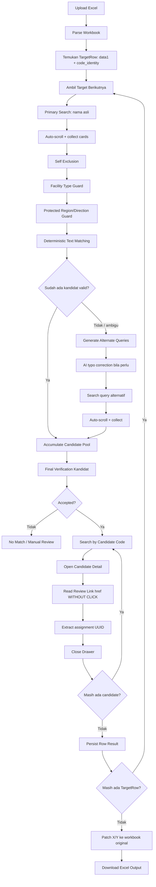

# IMPLEMENTATION_PLAN.md

## Chrome Extension — Automation Pengecekan Duplikat Assignment FASIH

**Status dokumen:** Implementation-ready specification  
**Target implementasi:** Chrome Extension Manifest V3  
**Bahasa implementasi:** TypeScript  
**Mode operasi:** User-assisted browser automation pada sesi FASIH yang sudah login  
**Input utama:** File Excel survei/penugasan  
**Output utama:** File Excel baru dengan `assignment_id_duplicate` dan `nama_duplicate` terisi  
**Prinsip utama:** deterministik dahulu, AI hanya membantu kasus typo/ambigu, tidak melakukan aksi yang mengubah data FASIH.
**Update DOM:** selector List View, Search Input, Assignment Card, Review Action, dan Close Drawer sudah dipetakan dari struktur HTML FASIH yang diberikan.

---

# 1. Tujuan Sistem

Membangun Chrome Extension yang mengotomatisasi proses pengecekan duplikat penugasan pada web FASIH berdasarkan daftar target dari file Excel.

Extension harus mampu:

1. Membaca file Excel tanpa mengubah struktur asli workbook.
2. Mengambil target per baris berdasarkan `data1` dan `code_identity`.
3. Mencari nama target pada halaman FASIH.
4. Menangani typo dan variasi penamaan.
5. Menembus daftar hasil yang menggunakan infinite scroll/virtualized list.
6. Mengumpulkan kandidat secara incremental, termasuk kartu yang hanya muncul setelah scroll.
7. Menolak data milik target itu sendiri berdasarkan `code_identity`.
8. Menolak kandidat dengan tipe fasilitas yang berbeda.
9. Menolak kandidat yang berbeda wilayah/arah/nomor identitas nama.
10. Melakukan pencocokan nama menggunakan algoritma lokal terlebih dahulu.
11. Memakai AI hanya untuk query correction dan kandidat ambigu.
12. Membuka detail kartu kandidat tanpa membuka tombol Review/Lanjutkan Penugasan.
13. Membaca URL/href tombol Review langsung dari DOM.
14. Mengekstrak UUID `assignment_id` dari URL tersebut.
15. Mendukung lebih dari satu duplikat pada satu target.
16. Menulis semua ID duplikat ke `assignment_id_duplicate`, dipisahkan `;`.
17. Menulis nama kartu duplikat aktual ke `nama_duplicate`, dengan urutan yang sejajar dengan ID.
18. Menghasilkan file Excel baru yang dapat langsung diunduh.
19. Mendukung pause, resume, retry, recovery, dan checkpoint.
20. Menghasilkan log yang cukup detail untuk debugging tanpa membocorkan credential.

---

# 2. Data Excel Acuan yang Sudah Diverifikasi

Berdasarkan file contoh `Pengecekan Duplikat Assignment.xlsx`, workbook memiliki sheet `Sheet2` dan struktur sampai kolom Z.

Kolom yang paling penting bagi automation:

| Kolom Excel | Header | Fungsi |
|---|---|---|
| A | `assignment_id` | ID assignment milik target/original; juga dapat dipakai sebagai safety check agar hasil duplikat tidak sama dengan assignment target |
| G | `data1` | Nama target/entitas yang dicari pada FASIH |
| H | `code_identity` | Kode unik target untuk self-exclusion |
| X | `assignment_id_duplicate` | Output seluruh assignment ID duplikat yang valid |
| Y | `nama_duplicate` | Output seluruh nama kandidat duplikat yang valid |
| Z | `catatan 2` | Jangan digunakan/diubah kecuali ada requirement baru |

Contoh target yang terdapat pada file:

- `Puskesmas Lolantang`
- `SDN PONDING-PONIDNG`
- `SMAN 1 TINANGKUNG`
- `Poskesdes Sub Desa Polintang`
- `Poskesdes Bulagi II`
- `Polindes Bangpanga`
- `Polindes Labangun`
- `TK NEGERI BONEPUSO`
- `Posyandu melati, puskesmas tinangkung utara`

## 2.1 Aturan pemilihan baris target

JANGAN memproses semua baris yang memiliki data di kolom lain.

Sebuah baris dianggap sebagai `TargetRow` hanya jika:

```text
data1 != kosong
AND
code_identity != kosong
```

Default tambahan:

```text
Jika assignment_id_duplicate sudah terisi:
    SKIP baris tersebut
```

Harus tersedia opsi UI:

```text
[ ] Proses ulang baris yang sudah memiliki output
```

Default = OFF.

## 2.2 Invariant Excel

Automation dilarang:

- mengubah urutan baris;
- menghapus sheet;
- mengganti nama sheet;
- menghapus kolom;
- mengubah formula yang sudah ada;
- mengubah data asli selain kolom output yang ditentukan;
- mengubah `assignment_id` original;
- mengubah `data1` original;
- mengubah `code_identity` original.

Pada export, kolom yang ditulis hanya:

```text
X = assignment_id_duplicate
Y = nama_duplicate
```

Kecuali user secara eksplisit mengaktifkan fitur output tambahan di masa depan.

---

# 3. Flow Utama Sistem



---

# 4. Prinsip Arsitektur

## 4.1 Arsitektur wajib

Gunakan Chrome Extension **Manifest V3**.

Pisahkan tanggung jawab menjadi komponen berikut:

1. **Side Panel UI**
   - upload Excel;
   - konfigurasi;
   - tombol Start/Pause/Resume/Stop;
   - status koneksi FASIH;
   - status koneksi AI;
   - progress;
   - log;
   - manual review queue;
   - download hasil.

2. **Content Script — FASIH Adapter**
   - hanya bertanggung jawab membaca/manipulasi DOM FASIH;
   - search input;
   - membaca kartu;
   - scrolling;
   - membuka/menutup drawer;
   - membaca link Review;
   - tidak menyimpan API key;
   - tidak memanggil AI langsung.

3. **Service Worker**
   - message router;
   - cross-origin request ke AI gateway localhost;
   - Chrome downloads;
   - health check;
   - tab coordination;
   - lifecycle hooks.

4. **Job Engine / Orchestrator**
   - state machine per target;
   - checkpoint;
   - retry;
   - pause/resume;
   - result persistence.

5. **Excel Adapter**
   - parsing workbook;
   - target extraction;
   - patch output X/Y;
   - export.

6. **Matching Engine**
   - text normalization;
   - facility classification;
   - protected tokens;
   - Levenshtein;
   - token overlap;
   - decision rules.

7. **AI Adapter**
   - typo correction;
   - alternate query generation;
   - semantic adjudication untuk kasus ambigu;
   - structured JSON output;
   - timeout/retry/cache.

8. **Persistence Layer**
   - IndexedDB untuk job/workbook/result/cache;
   - `chrome.storage.local` hanya untuk setting kecil dan job pointer.

---

# 5. Technology Stack yang Disarankan

## Core

- TypeScript
- Chrome Extension Manifest V3
- Vite sebagai bundler
- React untuk Side Panel UI
- IndexedDB untuk checkpoint/job persistence
- `xlsx`/SheetJS atau adapter Excel browser-compatible yang dipilih setelah preservation test
- `zod` untuk schema validation data internal dan AI response

## Testing

- Vitest untuk unit test
- jsdom untuk DOM fixture test
- Playwright hanya untuk test extension/E2E jika environment memungkinkan

## Constraint dependency

Jangan menambah library fuzzy matching besar jika algoritma berikut cukup dibuat lokal:

- normalization;
- Levenshtein;
- token set overlap;
- protected token comparison.

Tujuannya supaya extension ringan dan rule matching dapat diaudit.

---

# 6. Struktur Folder

```text
fasih-duplicate-automation/
├─ package.json
├─ tsconfig.json
├─ vite.config.ts
├─ manifest.json
├─ README.md
├─ IMPLEMENTATION_PLAN.md
├─ .gitignore
├─ src/
│  ├─ background/
│  │  ├─ service-worker.ts
│  │  ├─ message-router.ts
│  │  ├─ ai-proxy.ts
│  │  └─ download-manager.ts
│  │
│  ├─ content/
│  │  ├─ fasih-content.ts
│  │  └─ inject.ts
│  │
│  ├─ sidepanel/
│  │  ├─ index.html
│  │  ├─ main.tsx
│  │  ├─ App.tsx
│  │  ├─ components/
│  │  │  ├─ FilePicker.tsx
│  │  │  ├─ ConnectionStatus.tsx
│  │  │  ├─ RunControls.tsx
│  │  │  ├─ ProgressPanel.tsx
│  │  │  ├─ CurrentTargetCard.tsx
│  │  │  ├─ LogViewer.tsx
│  │  │  ├─ ManualReviewQueue.tsx
│  │  │  └─ SettingsPanel.tsx
│  │  └─ sidepanel.css
│  │
│  ├─ core/
│  │  ├─ job-engine.ts
│  │  ├─ state-machine.ts
│  │  ├─ retry.ts
│  │  ├─ cancellation.ts
│  │  └─ errors.ts
│  │
│  ├─ excel/
│  │  ├─ excel-adapter.ts
│  │  ├─ target-parser.ts
│  │  ├─ result-writer.ts
│  │  └─ excel-types.ts
│  │
│  ├─ matching/
│  │  ├─ normalize.ts
│  │  ├─ facility-type.ts
│  │  ├─ protected-tokens.ts
│  │  ├─ levenshtein.ts
│  │  ├─ token-overlap.ts
│  │  ├─ score.ts
│  │  └─ verifier.ts
│  │
│  ├─ ai/
│  │  ├─ ai-client.ts
│  │  ├─ prompts.ts
│  │  ├─ schemas.ts
│  │  ├─ query-generator.ts
│  │  └─ candidate-adjudicator.ts
│  │
│  ├─ site/
│  │  └─ fasih/
│  │     ├─ selectors.ts
│  │     ├─ dom-utils.ts
│  │     ├─ search-controller.ts
│  │     ├─ virtual-scroll.ts
│  │     ├─ card-parser.ts
│  │     ├─ drawer-controller.ts
│  │     ├─ review-link.ts
│  │     └─ site-types.ts
│  │
│  ├─ persistence/
│  │  ├─ db.ts
│  │  ├─ job-repository.ts
│  │  ├─ result-repository.ts
│  │  └─ ai-cache.ts
│  │
│  ├─ shared/
│  │  ├─ constants.ts
│  │  ├─ config.ts
│  │  ├─ messages.ts
│  │  ├─ logger.ts
│  │  ├─ types.ts
│  │  └─ uuid.ts
│  │
│  └─ fixtures/
│     ├─ search-results.html
│     ├─ drawer-detail.html
│     └─ matching-cases.json
│
├─ tests/
│  ├─ unit/
│  ├─ integration/
│  └─ e2e/
│
└─ docs/
   ├─ DOM_SELECTOR_NOTES.md
   ├─ MATCHING_RULES.md
   ├─ TROUBLESHOOTING.md
   └─ TEST_CASES.md
```

---

# 7. Manifest V3

Gunakan permission seminimal mungkin.

Contoh konsep:

```json
{
  "manifest_version": 3,
  "name": "FASIH Duplicate Assignment Automation",
  "version": "0.1.0",
  "permissions": [
    "storage",
    "downloads",
    "activeTab",
    "scripting",
    "sidePanel"
  ],
  "host_permissions": [
    "<FASIH_ORIGIN>/*",
    "http://localhost:20128/*"
  ],
  "background": {
    "service_worker": "background/service-worker.js",
    "type": "module"
  },
  "side_panel": {
    "default_path": "sidepanel/index.html"
  },
  "content_scripts": [
    {
      "matches": ["<FASIH_ORIGIN>/*"],
      "js": ["content/fasih-content.js"],
      "run_at": "document_idle"
    }
  ]
}
```

## Penting

- Ganti `<FASIH_ORIGIN>` dengan domain FASIH yang benar.
- Jangan gunakan `<all_urls>`.
- AI call dilakukan oleh service worker/extension page, bukan content script.
- Host permission localhost diperlukan untuk OpenAI-compatible gateway lokal.

---

# 8. Data Model Internal

## 8.1 TargetRow

```ts
export interface TargetRow {
  rowNumber: number;
  assignmentIdOriginal?: string;
  data1: string;
  codeIdentity: string;
  existingDuplicateIds?: string;
  existingDuplicateNames?: string;
}
```

## 8.2 SearchCandidate

```ts
export interface SearchCandidate {
  sourceQuery: string;
  cardName: string;
  cardCode: string;
  facilityType?: FacilityType;
  rawText: string;
  metadata: Record<string, string>;
}
```

## 8.3 CandidateEvaluation

```ts
export type CandidateDecision =
  | "ACCEPT"
  | "REJECT_SELF"
  | "REJECT_FACILITY"
  | "REJECT_PROTECTED_TOKEN"
  | "REJECT_SCORE"
  | "AI_REVIEW"
  | "MANUAL_REVIEW";

export interface CandidateEvaluation {
  candidate: SearchCandidate;
  decision: CandidateDecision;
  normalizedTarget: string;
  normalizedCandidate: string;
  levenshteinScore: number;
  tokenOverlapScore: number;
  combinedScore: number;
  facilityMatch: boolean | null;
  protectedTokenMatch: boolean;
  aiVerdict?: "same_entity" | "different_entity" | "uncertain";
  aiConfidence?: number;
  reasons: string[];
}
```

## 8.4 DuplicateResult

```ts
export interface DuplicateResult {
  candidateCode: string;
  candidateName: string;
  assignmentId: string;
}
```

## 8.5 RowResult

```ts
export interface RowResult {
  rowNumber: number;
  targetName: string;
  codeIdentity: string;
  status:
    | "DONE"
    | "NO_MATCH"
    | "MANUAL_REVIEW"
    | "ERROR"
    | "SKIPPED";
  duplicates: DuplicateResult[];
  queryHistory: string[];
  error?: string;
  updatedAt: string;
}
```

---

# 9. State Machine Per Baris

Setiap target WAJIB diproses sebagai state machine supaya resume/retry tidak kacau.

```ts
export type RowState =
  | "PENDING"
  | "PREPARING"
  | "PRIMARY_SEARCH"
  | "COLLECTING_PRIMARY"
  | "VERIFYING_PRIMARY"
  | "GENERATING_ALTERNATIVES"
  | "ALTERNATE_SEARCH"
  | "VERIFYING_FINAL"
  | "EXTRACTING_IDS"
  | "WRITING_RESULT"
  | "DONE"
  | "NO_MATCH"
  | "MANUAL_REVIEW"
  | "ERROR";
```

Transisi harus eksplisit dan dicatat di persistence.

```text
PENDING
  -> PREPARING
  -> PRIMARY_SEARCH
  -> COLLECTING_PRIMARY
  -> VERIFYING_PRIMARY
       -> jika confident: VERIFYING_FINAL
       -> jika belum: GENERATING_ALTERNATIVES
  -> ALTERNATE_SEARCH
  -> VERIFYING_FINAL
       -> jika accepted: EXTRACTING_IDS
       -> jika tidak: NO_MATCH / MANUAL_REVIEW
  -> EXTRACTING_IDS
  -> WRITING_RESULT
  -> DONE
```

Jika error yang retryable:

```text
CURRENT_STATE -> RETRY CURRENT_STATE
```

Jika retry habis:

```text
CURRENT_STATE -> ERROR
```

---

# 10. Tahap 1 — Excel Import & Target Parsing

## 10.1 Upload

Side panel menyediakan:

```text
[ Pilih File Excel ]
```

Accepted types:

```text
.xlsx
.xls (opsional jika library stabil mendukung)
```

Prioritaskan `.xlsx`.

## 10.2 Parsing workbook

Jangan convert Excel menjadi CSV karena:

- formula bisa hilang;
- sheet lain bisa hilang;
- tipe sel bisa berubah;
- struktur workbook bisa rusak.

Workbook original harus tetap menjadi basis export.

## 10.3 Header lookup

Jangan mengunci kolom berdasarkan huruf saja pada source code.

Gunakan nama header:

```ts
const requiredHeaders = [
  "data1",
  "code_identity",
  "assignment_id_duplicate",
  "nama_duplicate"
];
```

`assignment_id` sangat disarankan tetapi dapat dibuat optional untuk safety cross-check.

Flow:

```text
1. Baca row header.
2. Map headerName -> columnIndex.
3. Validasi required headers.
4. Tampilkan error yang jelas jika header hilang.
5. Cari semua baris dengan data1 + code_identity.
```

## 10.4 Persist original workbook

Karena side panel/service worker dapat di-suspend, jangan hanya menyimpan workbook di RAM.

Gunakan IndexedDB:

```text
jobs
originalFiles
rowResults
aiCache
```

Simpan original file sebagai Blob/ArrayBuffer di IndexedDB.

Pada export:

```text
1. Load ulang workbook original.
2. Terapkan hasil RowResult ke X/Y berdasarkan rowNumber/header index.
3. Export file baru.
```

Dengan pola ini, workbook asli lebih aman dari kerusakan state akibat pause/reload.

---

# 11. Tahap 2 — Search Controller FASIH

## 11.1 Selector strategy — DOM FASIH yang sudah diketahui

JANGAN menyebarkan selector di banyak file.

Semua selector harus berada di:

```text
src/site/fasih/selectors.ts
```

Selector berikut berasal dari struktur HTML FASIH yang sudah diidentifikasi dan menjadi **baseline implementasi**, bukan lagi placeholder generik.

Prinsip prioritas:

1. atribut `data-tsd-source` yang spesifik;
2. semantic/accessible attribute (`aria-label`, `title`, role);
3. struktur/ikon yang relatif stabil;
4. class semantic;
5. class layout/build sebagai fallback terakhir.

PENTING:

- selector broad tidak boleh langsung di-click tanpa validasi konteks;
- setiap resolver wajib memastikan elemen `visible`, tidak `disabled`, dan masih `isConnected`;
- elemen di dalam drawer harus dicari **dengan scope drawer**, bukan seluruh `document`;
- selector berbasis teks harus memakai predicate lokal, bukan XPath global yang berisiko salah target;
- setiap selector hit dicatat pada diagnostic log agar perubahan DOM FASIH mudah dilacak.

### 11.1.1 Central selector registry

Implementasi yang disarankan:

```ts
// src/site/fasih/selectors.ts

export const FASIH_SELECTORS = {
  listViewToggle: [
    'button[aria-label*="Tampilan List" i]',
    'button[title*="Tampilan List" i]',
    'button[aria-label*="list" i]',
    'button[title*="list" i]'
  ],

  listViewIcon: [
    'svg.tabler-icon-list'
  ],

  searchInput: [
    'input[data-tsd-source="assignment-search-input"]',
    'input[data-tsd-source*="assignment-search-input"]',
    'input[placeholder*="Cari" i]',
    'input[placeholder*="Search" i]',
    'input[data-tsd-source*="search"]',
    'input.mantine-TextInput-input',
    'input[type="search"]'
  ],

  assignmentCards: [
    '[data-tsd-source^="assignment-list-item-"]',
    '[data-tsd-source*="assignment-list-item"]'
  ],

  candidateDetailTrigger: [
    'a.font-semibold.underline',
    'button.font-semibold.underline',
    'a[class*="font-semibold"][class*="underline"]',
    'button[class*="font-semibold"][class*="underline"]'
  ],

  drawer: [
    '[role="dialog"]',
    '.mantine-Modal-root',
    '.mantine-Drawer-root'
  ],

  reviewAction: [
    'a[data-tsd-source="assignment-action-review"]',
    'a[data-tsd-source*="assignment-action-review"]',
    'a[data-tsd-source*="assignment-action"][href]',
    'a[href*="/survey/assignment/"][href*="/review"]',
    'a[href*="/assignment/"][href*="/review"]'
  ],

  reviewIcon: [
    'svg.tabler-icon-brand-telegram'
  ],

  closeButton: [
    'button[aria-label*="close" i]',
    'button[aria-label*="tutup" i]',
    'button.mantine-Modal-close',
    'button.mantine-Drawer-close',
    // Colon pada class utility harus di-escape di CSS selector.
    'button.f\\:top-4.f\\:right-4'
  ],

  closeIcon: [
    'svg.tabler-icon-x'
  ]
} as const;
```

Catatan penting:

- `button svg.tabler-icon-x` secara CSS sebenarnya menyeleksi SVG, bukan button. Resolver harus mendapatkan `svg.closest("button")`.
- Hal yang sama berlaku untuk `svg.tabler-icon-list` dan `svg.tabler-icon-brand-telegram`.
- Jangan menjadikan `a[href*="/assignment/"]` sebagai selector Review final tanpa predicate tambahan karena link detail kartu juga dapat memiliki route assignment.

### 11.1.2 Resolver contract

Jangan hanya membuat helper yang mengembalikan hasil `querySelector()` pertama. Gunakan resolver yang menerima selector list + validator.

```ts
export interface ResolveOptions<T extends Element> {
  root?: ParentNode;
  selectors: readonly string[];
  timeoutMs?: number;
  signal?: AbortSignal;
  validate?: (el: Element) => el is T;
}

export interface ResolvedElement<T extends Element> {
  element: T;
  selector: string;
}
```

Validator umum:

```ts
export function isVisible(el: Element): boolean {
  if (!(el instanceof HTMLElement)) return false;

  const style = getComputedStyle(el);
  const rect = el.getBoundingClientRect();

  return (
    style.display !== 'none' &&
    style.visibility !== 'hidden' &&
    Number(style.opacity || '1') > 0 &&
    rect.width > 0 &&
    rect.height > 0
  );
}

export function isUsableButton(el: Element): el is HTMLButtonElement {
  return (
    el instanceof HTMLButtonElement &&
    el.isConnected &&
    !el.disabled &&
    isVisible(el)
  );
}
```

### 11.1.3 Step 0 — Ensure List View

Sebelum search pertama pada sebuah job, extension WAJIB memastikan halaman berada pada tampilan List/Kartu.

Resolver:

```text
PRIMARY:
button[aria-label*="Tampilan List" i]

FALLBACK 1:
button[title*="Tampilan List" i]

FALLBACK 2:
button[aria-label*="list" i]
button[title*="list" i]

FALLBACK 3:
svg.tabler-icon-list -> closest("button")
```

Algoritma:

```text
1. Cek apakah assignment list/card sudah tersedia dan mode list tampak aktif.
2. Jika sudah List View -> JANGAN klik toggle lagi.
3. Jika belum:
   a. resolve tombol list;
   b. validasi visible + enabled;
   c. click sekali;
   d. tunggu search/list container stabil;
   e. verifikasi assignment card/list view dapat ditemukan.
4. Jika verifikasi gagal -> LIST_VIEW_SWITCH_FAILED.
```

Jangan mengasumsikan tombol toggle idempotent. Jika atribut seperti `aria-pressed`, `data-active`, atau class active tersedia pada DOM aktual, gunakan itu sebagai sinyal utama sebelum melakukan klik.

Contoh helper:

```ts
async function ensureListView(signal: AbortSignal): Promise<void> {
  if (isListViewAlreadyActive()) return;

  const button = await resolveListViewButton(signal);
  await clickElementSafely(button, signal);

  await waitForCondition(
    () => isListViewAlreadyActive() || hasAssignmentListSurface(),
    { timeoutMs: 5000, signal }
  );
}
```

### 11.1.4 Step 1 — Search Input

Target DOM utama:

```html
<input
  type="text"
  data-tsd-source="assignment-search-input"
  class="mantine-Input-input mantine-TextInput-input"
  placeholder="Cari penugasan..."
/>
```

Prioritas resolver:

```text
1. input[data-tsd-source="assignment-search-input"]
2. input[data-tsd-source*="assignment-search-input"]
3. input[placeholder*="Cari" i]
4. input[placeholder*="Search" i]
5. input[data-tsd-source*="search"]
6. input.mantine-TextInput-input
7. input[type="search"]
```

Validasi wajib:

```text
- instanceof HTMLInputElement
- visible
- !disabled
- !readOnly
- terhubung ke DOM
```

Flow penulisan query:

```text
focus
-> select existing value
-> native setter = ""
-> dispatch input/change
-> native setter = query baru
-> dispatch input/change
-> optional Enter hanya jika hasil FASIH memang membutuhkan Enter
-> tunggu hasil berubah/settle
```

Setelah query diset, lakukan assertion:

```ts
if (searchInput.value.trim() !== query.trim()) {
  throw new FasihDomError('SEARCH_VALUE_NOT_APPLIED');
}
```

### 11.1.5 Step 2 — Assignment Card Collection

Target utama:

```html
<div data-tsd-source="assignment-list-item-SE26mpewbw33D8">
  <a href="/assignment/detail/..." class="font-semibold underline ...">
    SE26mpewbw33D8 - Polindes Labangun
  </a>
</div>
```

Card root:

```text
[data-tsd-source^="assignment-list-item-"]
```

Fallback:

```text
[data-tsd-source*="assignment-list-item"]
```

Kode kartu sebaiknya diekstrak dengan urutan:

```text
1. suffix dari data-tsd-source assignment-list-item-<CODE>
2. text pada detail trigger
3. parser rawText sebagai fallback
```

Contoh parser:

```ts
function parseCodeFromCard(card: HTMLElement): string | null {
  const source = card.getAttribute('data-tsd-source') ?? '';
  const prefix = 'assignment-list-item-';

  if (source.startsWith(prefix)) {
    return source.slice(prefix.length).trim() || null;
  }

  return parseIdentityCodeFromText(card.innerText);
}
```

PENTING untuk virtualized list:

- jangan menyimpan reference DOM kartu untuk digunakan jauh setelah scroll;
- simpan data primitive (`cardCode`, `cardName`, `rawText`);
- saat akan klik kandidat, lakukan **re-resolve DOM berdasarkan exact code**;
- DOM node lama mungkin sudah di-recycle framework virtualization.

### 11.1.6 Step 3 — Exact Candidate Detail Trigger

JANGAN klik kartu pertama.

Untuk candidate code yang sudah accepted:

```text
expectedCode = canonical(candidate.cardCode)
```

Kemudian cari card root yang code-nya EXACT sama.

Di dalam card tersebut saja, cari trigger:

```text
PRIMARY:
a.font-semibold.underline

FALLBACK:
button.font-semibold.underline

a[class*="font-semibold"][class*="underline"]
button[class*="font-semibold"][class*="underline"]
```

Jika selector trigger tidak ditemukan, cari descendant `<a>`/`<button>` yang teksnya mengandung exact `expectedCode`.

Validator:

```text
- trigger berada di dalam card exact code
- visible
- bukan disabled
- teks/card masih mengandung expected candidate code
```

Baru setelah itu lakukan klik untuk membuka detail drawer/modal.

### 11.1.7 Step 4 — Review Link / Assignment ID Extraction

Target ideal:

```html
<a
  href="https://fasih.bps.go.id/survey/assignment/d63944e0-a545-4dab-9b52-8604bd861767/review"
  data-tsd-source="assignment-action-review"
>
  ...
  Review
</a>
```

**BOT DILARANG mengklik tombol Review.**

Search harus dilakukan dalam scope drawer:

```ts
const drawer = await waitForFasihDrawer(...);
const review = await resolveReviewAnchor(drawer, ...);
```

Prioritas:

```text
1. a[data-tsd-source="assignment-action-review"]
2. a[data-tsd-source*="assignment-action-review"]
3. a[data-tsd-source*="assignment-action"][href] + text contains Review
4. a[href*="/survey/assignment/"][href*="/review"]
5. a[href*="/assignment/"][href*="/review"]
6. svg.tabler-icon-brand-telegram -> closest("a") + Review predicate
```

Broad fallback seperti:

```text
a[href*="/assignment/"]
```

**tidak boleh diterima sendirian.** Harus memenuhi minimal salah satu:

```text
- data-tsd-source menunjukkan action review; ATAU
- textContent mengandung "Review"; ATAU
- href memiliki suffix/segment /review.
```

Validator final Review anchor:

```ts
function isValidReviewAnchor(
  el: Element,
  drawer: Element
): el is HTMLAnchorElement {
  if (!(el instanceof HTMLAnchorElement)) return false;
  if (!drawer.contains(el)) return false;
  if (!el.href) return false;
  if (!isVisible(el)) return false;

  const source = (el.getAttribute('data-tsd-source') ?? '').toLowerCase();
  const text = (el.textContent ?? '').trim().toLowerCase();
  const href = el.href.toLowerCase();

  const semanticallyReview =
    source.includes('assignment-action-review') ||
    text.includes('review') ||
    href.includes('/review');

  return semanticallyReview && href.includes('/assignment/');
}
```

Setelah anchor valid:

```ts
const href = reviewAnchor.href; // BACA SAJA
const assignmentId = extractAssignmentUuid(href);
```

DILARANG:

```ts
reviewAnchor.click();
window.location.href = reviewAnchor.href;
window.open(reviewAnchor.href);
```

Untuk requirement user "klik kanan -> copy link", implementasi programatik ekuivalen dan lebih aman adalah membaca `HTMLAnchorElement.href` langsung. Tidak perlu context-menu simulation maupun clipboard.

### 11.1.8 Step 5 — Close Drawer / Modal

Prioritas close:

```text
1. button[aria-label*="close" i]
2. button[aria-label*="tutup" i]
3. button.mantine-Modal-close
4. button.mantine-Drawer-close
5. svg.tabler-icon-x -> closest("button")
6. button.f\\:top-4.f\\:right-4
7. Escape keyboard fallback
```

Pencarian close button dilakukan di dalam drawer/modal bila memungkinkan.

Contoh resolver icon:

```ts
const closeIcon = drawer.querySelector('svg.tabler-icon-x');
const closeFromIcon = closeIcon?.closest('button');
```

Setelah click/Escape:

```text
wait sampai drawer lama:
- tidak connected; ATAU
- tidak visible; ATAU
- role dialog/detail surface sudah hilang.
```

JANGAN memulai kandidat berikutnya sebelum close verification berhasil.

Jika close gagal:

```text
1. retry close button resolve;
2. tekan Escape satu kali;
3. wait gone;
4. jika tetap terbuka -> DRAWER_CLOSE_FAILED;
5. hentikan extraction candidate saat itu, jangan melakukan click random.
```

### 11.1.9 Selector diagnostics

Setiap resolver mencatat minimal:

```ts
interface SelectorDiagnostic {
  key:
    | 'listViewToggle'
    | 'searchInput'
    | 'assignmentCard'
    | 'candidateDetailTrigger'
    | 'drawer'
    | 'reviewAction'
    | 'closeButton';
  matchedSelector: string;
  timestamp: string;
}
```

Jika semua fallback gagal, error harus menyimpan:

```text
- selector key yang gagal
- route/path halaman saat itu
- state machine state
- candidate code jika relevan
- jumlah card visible
```

Jangan menyimpan cookie, token auth, password, atau full page HTML ke log default.

### 11.1.10 Selector acceptance criteria

Selector integration dianggap selesai hanya jika semua skenario ini lolos:

```text
[ ] List view toggle ditemukan dari aria/title atau icon fallback.
[ ] Bot tidak toggle ulang jika list view sudah aktif.
[ ] Search input ditemukan dari data-tsd-source pada DOM utama.
[ ] Query benar-benar masuk ke controlled input FASIH.
[ ] Assignment card diparse dari assignment-list-item-*.
[ ] Candidate code diperoleh dan diverifikasi exact.
[ ] Kandidat yang diklik selalu card dengan code yang diminta.
[ ] Drawer terbuka tanpa full page reload.
[ ] Review anchor ditemukan di dalam drawer.
[ ] Review href dibaca tanpa click/navigate.
[ ] UUID berhasil diekstrak dari href.
[ ] Close button ditemukan via semantic selector/icon fallback.
[ ] Escape hanya dipakai sebagai fallback close.
[ ] Bot menunggu drawer benar-benar hilang sebelum kandidat berikut.
[ ] Perubahan satu selector tidak membutuhkan perubahan di orchestrator/matching engine.
```

## 11.2 Controlled React/Vue input

Jika search input dikontrol framework, assignment langsung:

```ts
input.value = query;
```

mungkin tidak memicu pencarian.

Gunakan native setter + event:

```ts
function setNativeInputValue(input: HTMLInputElement, value: string) {
  const setter = Object.getOwnPropertyDescriptor(
    HTMLInputElement.prototype,
    "value"
  )?.set;

  setter?.call(input, value);
  input.dispatchEvent(new Event("input", { bubbles: true }));
  input.dispatchEvent(new Event("change", { bubbles: true }));
}
```

Jika site memerlukan keyboard event, tambahkan hanya jika dibutuhkan berdasarkan DOM behavior aktual.

## 11.3 Jangan menggunakan sleep sebagai mekanisme utama

Hindari:

```ts
await sleep(3000);
```

sebagai satu-satunya wait.

Gunakan:

- `MutationObserver`;
- polling condition dengan timeout;
- perubahan jumlah kartu;
- loading indicator disappear;
- DOM idle window.

Sleep kecil 100–400 ms boleh digunakan untuk debounce/jitter setelah event, bukan sebagai sinkronisasi utama.

---

# 12. Auto-Scroll Engine untuk Virtualized List

Ini komponen kritis.

Masalah:

- kartu di bawah viewport belum dirender;
- DOM node dapat didaur ulang;
- hanya membaca `querySelectorAll()` satu kali akan kehilangan kandidat.

## 12.1 Strategi

1. Detect scroll container hasil.
2. Scroll ke atas.
3. Pada setiap posisi:
   - baca semua kartu yang sedang visible/rendered;
   - parse card name + card code;
   - simpan ke `Map<normalizedCode, SearchCandidate>`;
   - scroll turun ~70–85% tinggi viewport;
   - tunggu DOM berubah/idle.
4. Ulangi sampai stop condition.

## 12.2 Stop condition

Stop jika salah satu terpenuhi:

```text
A. scrollTop + clientHeight >= scrollHeight - tolerance
B. tidak ada candidate code baru selama 3 pass berturut-turut
C. mencapai MAX_SCROLL_PASSES
D. user menekan Pause/Stop
E. search query berubah / context invalid
```

Suggested initial configuration:

```ts
export const SCROLL_CONFIG = {
  stepRatio: 0.8,
  noNewCandidateRoundsToStop: 3,
  maxPasses: 40,
  settleTimeoutMs: 2000
};
```

Nilai harus configurable.

## 12.3 Candidate dedupe

Jangan dedupe berdasarkan nama saja.

Gunakan kode kartu sebagai primary key:

```ts
candidateMap.set(normalizeIdentityCode(card.cardCode), card);
```

Jika card code tidak berhasil diekstrak, kandidat tidak boleh langsung dipercaya; log sebagai parsing error/manual review.

---

# 13. Tahap 3 — Search Strategy

Untuk setiap target:

## Query 1 — Original

```text
query = data1 original
```

Contoh:

```text
SDN PONDING-PONIDNG
```

Kumpulkan semua kartu setelah auto-scroll.

## Query 2 — Normalized

Jika Query 1 belum menghasilkan accepted candidate:

```text
SDN PONDING PONIDNG
```

Normalisasi punctuation/whitespace saja; jangan mengubah makna.

## Query 3 — AI corrected query

Hanya jika masih gagal atau hasil hanya self/ambigu.

Contoh:

```text
SDN PONDING-PONIDNG
-> SDN PONDING-PONDING
```

## Query 4 — Core token

Ekstrak kata pembeda utama.

Contoh:

```text
TK NEGERI BONEPUSO
-> BONEPUSO

Polindes Labangun
-> LABANGUN
```

## Query limit

Jangan membuat puluhan query.

Default:

```ts
MAX_QUERIES_PER_TARGET = 4
MAX_AI_QUERY_VARIANTS = 2
```

Semua query harus di-dedupe setelah normalization.

---

# 14. Text Normalization

Implement di:

```text
src/matching/normalize.ts
```

## 14.1 Basic normalization

Suggested pipeline:

```text
1. String -> uppercase
2. Unicode normalize
3. Trim
4. Replace punctuation separators dengan whitespace
5. Collapse multiple whitespace
6. Normalize hyphen spacing
7. Preserve number
8. Preserve direction tokens
9. Preserve significant roman numeral
```

Contoh:

```text
" Posyandu melati, puskesmas tinangkung utara "
-> "POSYANDU MELATI PUSKESMAS TINANGKUNG UTARA"
```

## 14.2 Alias normalization

Alias digunakan untuk comparison, bukan untuk mengubah data asli.

Contoh:

```text
SDN -> SD NEGERI
SMAN -> SMA NEGERI
SMPN -> SMP NEGERI
```

Jangan melakukan alias yang terlalu agresif.

## 14.3 Identity code normalization

Kode tidak boleh fuzzy matched.

```ts
function normalizeIdentityCode(code: string): string {
  return code
    .trim()
    .toUpperCase()
    .replace(/\s+/g, " ")
    .replace(/\s*-\s*/g, "-");
}
```

Self-exclusion:

```ts
normalizeIdentityCode(candidate.cardCode) ===
normalizeIdentityCode(target.codeIdentity)
```

Harus exact setelah canonical formatting.

---

# 15. Layer 1 — Self-Exclusion

Ini hard rule.

```text
IF candidate.code == target.code_identity
THEN REJECT_SELF
```

Jangan kirim kandidat self ke AI untuk meminta AI mengubah keputusan.

AI tidak boleh override self-exclusion.

Tambahan safety setelah assignment ID diekstrak:

```text
IF extractedAssignmentId == target.assignment_id
THEN reject result + log SELF_ASSIGNMENT_ID_COLLISION
```

---

# 16. Layer 2 — Facility Type Guard

Implement facility classifier lokal.

## 16.1 Suggested facility types

```ts
export type FacilityType =
  | "EDU_TK"
  | "EDU_KB"
  | "EDU_PAUD"
  | "EDU_SD"
  | "EDU_SMP"
  | "EDU_SMA"
  | "HEALTH_PUSKESMAS"
  | "HEALTH_PUSTU"
  | "HEALTH_POLINDES"
  | "HEALTH_POSKESDES"
  | "HEALTH_POSYANDU"
  | "MARKET"
  | "GOVERNMENT"
  | "OTHER"
  | "UNKNOWN";
```

## 16.2 Example mapping

```text
TK, TK NEGERI           -> EDU_TK
KB                      -> EDU_KB
PAUD                    -> EDU_PAUD
SD, SDN, SD NEGERI      -> EDU_SD
SMP, SMPN               -> EDU_SMP
SMA, SMAN               -> EDU_SMA
PUSKESMAS               -> HEALTH_PUSKESMAS
PUSTU                   -> HEALTH_PUSTU
POLINDES                 -> HEALTH_POLINDES
POSKESDES                -> HEALTH_POSKESDES
POSYANDU                 -> HEALTH_POSYANDU
```

## 16.3 Decision

```text
Known target type + known candidate type + different
=> hard reject
```

Contoh:

```text
Target: POLINDES LABANGUN
Candidate: POSKESDES LABANGUN
=> REJECT_FACILITY
```

Meskipun token `LABANGUN` sama.

Jika salah satu type `UNKNOWN`, jangan langsung reject; naikkan strictness atau AI review.

---

# 17. Layer 3 — Region / Direction / Number Guard

Buat daftar `PROTECTED_TOKENS`.

Minimum:

```text
UTARA
SELATAN
TIMUR
BARAT
TENGAH
HULU
HILIR
```

Nomor digit juga protected:

```text
1, 2, 3, ...
```

Roman numeral yang menjadi bagian nama juga dianggap penting:

```text
I, II, III, IV, V
```

## 17.1 Hard mismatch example

```text
Target    : SMAN 1 TINANGKUNG
Candidate : SMAN 1 TINANGKUNG UTARA

Target direction tokens    = {}
Candidate direction tokens = {UTARA}

=> REJECT_PROTECTED_TOKEN
```

Contoh lain:

```text
SMAN 1 TINANGKUNG
SMAN 2 TINANGKUNG
=> REJECT_PROTECTED_TOKEN karena number mismatch
```

AI tidak boleh override hard number/direction mismatch secara otomatis.

Jika ditemukan exception nyata di production, exception harus menjadi rule eksplisit yang didokumentasikan, bukan prompt rahasia.

---

# 18. Layer 4 — Strict Token Match + Levenshtein

## 18.1 Generic tokens

Generic tokens tidak boleh menjadi bukti utama kecocokan.

Suggested list awal:

```text
NEGERI
DESA
KELURAHAN
KECAMATAN
KABUPATEN
SEKOLAH
TK
PAUD
KB
SD
SDN
SMP
SMPN
SMA
SMAN
PUSKESMAS
PUSTU
POLINDES
POSKESDES
POSYANDU
PASAR
UNIT
UPT
```

List harus configurable.

## 18.2 Core tokens

```ts
coreTokens = allTokens - genericTokens
```

Contoh:

```text
TK NEGERI BONEPUSO
all       = [TK, NEGERI, BONEPUSO]
core      = [BONEPUSO]
```

Jika kedua nama hanya match pada generic tokens:

```text
REJECT
```

## 18.3 Levenshtein ratio

```text
levenshteinSimilarity =
1 - editDistance(a, b) / max(length(a), length(b))
```

Range:

```text
0.0 .. 1.0
```

## 18.4 Token overlap

Gunakan token set similarity/Jaccard pada token signifikan:

```text
intersection(coreTarget, coreCandidate)
---------------------------------------
union(coreTarget, coreCandidate)
```

Untuk typo, tambahkan token-level fuzzy equivalence agar token dengan edit distance kecil dapat dianggap near-match.

## 18.5 Suggested combined score

Initial tunable formula:

```ts
combinedScore =
  0.55 * tokenOverlapScore +
  0.45 * levenshteinScore;
```

Ini BUKAN threshold final ilmiah; harus dikalibrasi menggunakan sampel known-good/known-bad dari pekerjaan nyata.

Initial decision band yang disarankan:

```text
>= 0.92    : deterministic ACCEPT jika semua hard guards pass
0.72-0.919 : AI_REVIEW
< 0.72     : REJECT kecuali query typo khusus menghasilkan evidence lebih kuat
```

Lakukan calibration sebelum release production.

---

# 19. Decision Pipeline Kandidat

Pseudocode:

```ts
async function evaluateCandidate(
  target: TargetRow,
  candidate: SearchCandidate
): Promise<CandidateEvaluation> {

  if (isSameIdentityCode(target.codeIdentity, candidate.cardCode)) {
    return reject("REJECT_SELF");
  }

  const targetType = detectFacilityType(target.data1);
  const candidateType = detectFacilityType(candidate.cardName);

  if (isHardFacilityMismatch(targetType, candidateType)) {
    return reject("REJECT_FACILITY");
  }

  if (!protectedTokensCompatible(target.data1, candidate.cardName)) {
    return reject("REJECT_PROTECTED_TOKEN");
  }

  const scores = calculateTextScores(target.data1, candidate.cardName);

  if (scores.onlyGenericMatch) {
    return reject("REJECT_SCORE");
  }

  if (scores.combined >= CONFIG.autoAcceptThreshold) {
    return accept();
  }

  if (scores.combined >= CONFIG.aiReviewThreshold) {
    return aiReview();
  }

  return reject("REJECT_SCORE");
}
```

---

# 20. AI Strategy

AI bukan sumber kebenaran tunggal.

AI hanya memiliki dua tugas:

1. menghasilkan variasi query yang masuk akal;
2. membantu adjudication pasangan nama yang lolos hard guards tetapi masih ambigu.

AI DILARANG:

- menentukan `code_identity`;
- mengarang candidate code;
- mengarang assignment ID;
- memilih kandidat yang tidak pernah ditemukan DOM;
- override self-exclusion;
- override facility hard mismatch;
- override direction/number hard mismatch;
- melakukan aksi DOM.

---

# 21. Konfigurasi AI

Konfigurasi default berdasarkan environment user:

```text
Provider type : OpenAI-compatible
Base URL      : http://localhost:20128/v1
Model         : cmc/deepseek/deepseek-v4-flash
API key       : SECRET — jangan ditulis di source code/repository
```

Endpoint chat:

```text
POST {baseUrl}/chat/completions
```

Health/model check opsional:

```text
GET {baseUrl}/models
```

## 21.1 Jangan hardcode API key

DILARANG:

```ts
const API_KEY = "sk-...";
```

Gunakan salah satu:

### Preferred

Local bridge/gateway menyimpan upstream credential dan extension hanya menggunakan token lokal/scoped.

### Acceptable untuk penggunaan pribadi

User memasukkan key di Settings extension dan value disimpan di `chrome.storage.local`.

Tetap:

- jangan log value;
- jangan tampilkan full value setelah disimpan;
- tampilkan masked value;
- sediakan tombol Clear Key.

Perlu dipahami bahwa source/bundle Chrome Extension dapat diperiksa pengguna lokal, sehingga secret tidak boleh dibundel.

---

# 22. AI Request Configuration

Untuk entity matching, output harus pendek dan stabil.

Suggested defaults:

```ts
{
  temperature: 0.1,
  max_tokens: 300
}
```

Jika provider mendukung JSON response format, gunakan structured JSON.

Timeout:

```text
AI_TIMEOUT_MS = 12_000
```

Retry:

```text
maksimum 2 retry untuk timeout/5xx
jangan retry 4xx credential/configuration error
```

Jika AI mati:

```text
- automation TIDAK boleh crash seluruh job;
- lanjutkan deterministic matching;
- kasus ambigu masuk MANUAL_REVIEW.
```

---

# 23. Prompt — Query Correction

System intent:

```text
Anda membantu mengoreksi typo nama fasilitas/entitas Indonesia untuk kebutuhan pencarian.
Jangan mengarang lokasi atau nama baru.
Pertahankan tipe fasilitas, nomor, dan penanda arah.
Keluarkan JSON saja.
```

Input:

```json
{
  "target_name": "SDN PONDING-PONIDNG",
  "facility_type": "EDU_SD",
  "protected_tokens": []
}
```

Expected schema:

```json
{
  "corrected_name": "SDN PONDING-PONDING",
  "query_variants": [
    "SDN PONDING-PONDING",
    "PONDING-PONDING"
  ],
  "confidence": 0.93
}
```

Rules:

- max 2 variants;
- no extra prose;
- preserve facility type;
- preserve number;
- preserve direction;
- correction bukan kandidat final, hanya search query.

---

# 24. Prompt — Candidate Adjudication

AI hanya dipanggil setelah hard guards pass.

Input:

```json
{
  "target": {
    "name": "...",
    "facility_type": "...",
    "protected_tokens": ["..."]
  },
  "candidate": {
    "name": "...",
    "facility_type": "...",
    "protected_tokens": ["..."]
  },
  "local_scores": {
    "levenshtein": 0.0,
    "token_overlap": 0.0,
    "combined": 0.0
  }
}
```

Expected JSON:

```json
{
  "verdict": "same_entity",
  "confidence": 0.91,
  "reason": "Likely typo variant with same distinctive location token."
}
```

Allowed verdict:

```text
same_entity
different_entity
uncertain
```

## Final AI acceptance

Suggested:

```text
AI verdict = same_entity
AND confidence >= 0.85
AND all local hard guards pass
=> ACCEPT
```

`uncertain` -> manual review.

---

# 25. AI Cache

AI call dapat berulang pada query/candidate yang sama.

Cache key:

```text
query-correction:
sha256(normalizedTarget + model + promptVersion)

candidate-review:
sha256(normalizedTarget + normalizedCandidate + model + promptVersion)
```

Simpan:

- request hash;
- response JSON;
- model;
- prompt version;
- timestamp.

Jangan simpan API key.

---

# 26. Candidate Pool Across Queries

Jangan langsung membuang kandidat dari query sebelumnya.

Untuk satu target:

```ts
const candidatePool = new Map<string, SearchCandidate>();
```

Setiap query:

```text
collect -> normalize code -> merge ke pool
```

Setelah semua query yang diperlukan selesai:

```text
candidatePool
-> self exclusion
-> facility guard
-> protected guard
-> local score
-> AI ambiguous
-> final accepted candidates
```

Satu kandidat yang muncul pada 3 query tetap hanya satu kandidat.

---

# 27. Kapan Search Alternatif Berhenti

Jangan selalu menjalankan semua query.

Stop early jika:

```text
- primary search sudah menghasilkan satu/lebih candidate ACCEPT dengan confidence tinggi;
- tidak ada indikasi candidate lain yang terlewat;
```

Namun untuk kasus yang memang memungkinkan lebih dari satu duplikat, primary result list tetap harus discroll hingga completion sebelum stop.

Jika primary menghasilkan accepted candidate tetapi list masih mempunyai banyak card, tetap kumpulkan seluruh list untuk menemukan multiple duplicates.

---

# 28. Tahap 4 — Assignment ID Sniper Extraction

Setelah daftar kandidat ACCEPT final tersedia, ekstrak ID satu per satu.

## 28.1 Important invariant

**JANGAN klik tombol Review/Lanjutkan Penugasan.**

Yang dibutuhkan hanya URL/href tombol tersebut.

Jika element adalah anchor:

```ts
const href = reviewAnchor.href || reviewAnchor.getAttribute("href");
```

Ini ekuivalen secara teknis dengan membaca alamat link tanpa melakukan navigasi dan jauh lebih reliable dibanding mensimulasikan klik kanan.

## 28.2 Flow per candidate

```text
1. Search berdasarkan candidate.cardCode.
2. Tunggu search results settle.
3. Auto-scroll bila perlu.
4. Cari card dengan exact canonical code.
5. Klik badan kartu/detail trigger.
6. Tunggu drawer/detail panel visible.
7. Temukan Review/Lanjutkan Penugasan anchor.
8. BACA href saja.
9. Extract UUID.
10. Validate UUID.
11. Pastikan UUID != target assignment_id original.
12. Tutup drawer.
13. Lanjut kandidat berikutnya.
```

## 28.3 Search by code harus exact

Setelah hasil muncul:

```text
candidate.code normalized == expected candidate.code normalized
```

Jangan otomatis mengambil kartu pertama tanpa verifikasi kode.

---

# 29. UUID Extraction

Gunakan parser URL + regex fallback.

UUID regex:

```ts
const UUID_REGEX =
  /\b[0-9a-f]{8}-[0-9a-f]{4}-[1-5][0-9a-f]{3}-[89ab][0-9a-f]{3}-[0-9a-f]{12}\b/i;
```

Jika sistem FASIH menggunakan UUID yang tidak strict versioned, fallback:

```ts
const UUID_LOOSE_REGEX =
  /\b[0-9a-f]{8}-[0-9a-f]{4}-[0-9a-f]{4}-[0-9a-f]{4}-[0-9a-f]{12}\b/i;
```

Prioritas extraction:

```text
1. known URL query param, jika diketahui dari DOM aktual;
2. known route segment;
3. UUID regex dari href.
```

Jika tidak ada UUID:

```text
candidate -> extraction error
jangan mengarang ID
```

---

# 30. Drawer Controller

Drawer controller harus memakai selector registry pada §11.1 dan tidak mengulang selector literal di file controller.

Open:

```text
1. Re-resolve card berdasarkan exact candidate code.
2. Resolve detail trigger hanya di dalam card tersebut.
3. Click detail trigger.
4. wait until drawer/modal visible.
5. wait until content drawer settle.
6. resolve Review anchor di dalam scope drawer.
7. validate href sebelum extraction.
```

Tidak boleh menyimpan reference card dari fase auto-scroll lalu mengklik reference lama, karena DOM virtualized dapat mendaur ulang node.

Review extraction:

```text
resolve drawer
-> resolve valid Review <a href>
-> read anchor.href
-> extract UUID
-> validate UUID
-> NEVER click Review
```

Close priority:

```text
1. button[aria-label*="close" i]
2. button[aria-label*="tutup" i]
3. Mantine modal/drawer close button
4. svg.tabler-icon-x -> closest("button")
5. utility-position button fallback
6. Escape key
7. verify drawer benar-benar hilang
```

Implementation rule:

```ts
async function closeAssignmentDrawer(
  drawer: HTMLElement,
  signal: AbortSignal
): Promise<void> {
  const closeButton = findDrawerCloseButton(drawer);

  if (closeButton) {
    await clickElementSafely(closeButton, signal);
  } else {
    await pressEscape();
  }

  await waitForElementGoneOrHidden(drawer, {
    timeoutMs: 5000,
    signal
  });
}
```

Jangan lanjut ke kandidat berikut sebelum drawer sebelumnya benar-benar tertutup.

Typed errors minimal:

```text
DRAWER_OPEN_TIMEOUT
DRAWER_NOT_FOUND
REVIEW_ACTION_NOT_FOUND
REVIEW_ACTION_INVALID
REVIEW_HREF_MISSING
DRAWER_CLOSE_FAILED
```

Timeout/recoverable DOM change harus menghasilkan error yang dapat di-retry secara terkontrol, bukan random click fallback.

---

# 31. Multiple Duplicate Handling

Contoh requirement:

```text
Polindes Labangun -> bisa mempunyai 4 duplikat
```

Internal result:

```ts
[
  { candidateName: "...", candidateCode: "...", assignmentId: "uuid-1" },
  { candidateName: "...", candidateCode: "...", assignmentId: "uuid-2" },
  { candidateName: "...", candidateCode: "...", assignmentId: "uuid-3" },
  { candidateName: "...", candidateCode: "...", assignmentId: "uuid-4" }
]
```

Before export:

- dedupe by `assignmentId`;
- deterministic sort agar hasil stabil;
- nama dan ID harus menggunakan urutan pair yang sama.

Suggested deterministic sort:

```text
candidateName normalized ASC
then candidateCode normalized ASC
```

Output:

```text
assignment_id_duplicate:
uuid-1;uuid-2;uuid-3;uuid-4

nama_duplicate:
Nama 1;Nama 2;Nama 3;Nama 4
```

Jangan menggunakan koma sebagai separator ID.

---

# 32. Nama Duplicate yang Ditulis

`nama_duplicate` harus menggunakan **nama aktual yang dibaca dari kartu FASIH**, bukan nama koreksi AI.

Contoh:

```text
Target Excel      : SDN PONDING-PONIDNG
AI corrected query: SDN PONDING-PONDING
Card FASIH        : SD NEGERI PONDING-PONDING

nama_duplicate output = SD NEGERI PONDING-PONDING
```

AI corrected name hanya alat pencarian.

---

# 33. Output Jika Tidak Ada Duplicate

Default:

```text
assignment_id_duplicate = blank
nama_duplicate = blank
```

Status `NO_MATCH` hanya disimpan di internal job result/log.

Jangan menulis kata `TIDAK ADA`, `NONE`, atau pesan error ke kolom output karena dapat merusak format downstream.

---

# 34. Job Persistence & Resume

Long-running automation tidak boleh mengandalkan RAM saja.

Persist setelah:

- file selesai diparse;
- target list dibuat;
- query selesai;
- row selesai;
- row error;
- user pause;
- assignment ID berhasil diekstrak.

Job object:

```ts
interface JobState {
  id: string;
  sourceFileName: string;
  sheetName: string;
  status: "READY" | "RUNNING" | "PAUSED" | "STOPPED" | "DONE" | "ERROR";
  currentTargetIndex: number;
  targetCount: number;
  processedCount: number;
  successCount: number;
  noMatchCount: number;
  manualReviewCount: number;
  errorCount: number;
  startedAt?: string;
  updatedAt: string;
}
```

## Resume behavior

Jika side panel ditutup/reload:

```text
1. Read current job.
2. Detect FASIH tab.
3. Reconnect content script.
4. Restore current target index.
5. Do not redo DONE rows unless configured.
6. Continue from safe state boundary.
```

Safe resume boundary terbaik = awal target atau awal extraction candidate.

Jangan resume di tengah DOM operation yang tidak dapat diverifikasi.

---

# 35. Pause / Stop Semantics

## Pause

- selesaikan atomic operation pendek yang sedang berjalan;
- jangan mulai query/candidate baru;
- persist state;
- status -> PAUSED.

## Stop

- cancel outstanding wait/fetch;
- persist partial results;
- status -> STOPPED;
- hasil parsial tetap dapat diexport jika user memilih.

Gunakan `AbortController` untuk:

- AI fetch;
- polling/wait helpers;
- job cancellation.

---

# 36. Error Taxonomy

Buat typed errors.

```ts
export type AutomationErrorCode =
  | "EXCEL_INVALID"
  | "EXCEL_HEADER_MISSING"
  | "FASIH_TAB_NOT_FOUND"
  | "FASIH_NOT_LOGGED_IN"
  | "SEARCH_INPUT_NOT_FOUND"
  | "SEARCH_TIMEOUT"
  | "RESULT_CONTAINER_NOT_FOUND"
  | "CARD_PARSE_FAILED"
  | "DRAWER_OPEN_TIMEOUT"
  | "REVIEW_LINK_NOT_FOUND"
  | "ASSIGNMENT_UUID_NOT_FOUND"
  | "AI_UNREACHABLE"
  | "AI_AUTH_FAILED"
  | "AI_INVALID_RESPONSE"
  | "DOM_CHANGED"
  | "JOB_CANCELLED";
```

Retryable examples:

```text
SEARCH_TIMEOUT
DRAWER_OPEN_TIMEOUT
AI_UNREACHABLE
DOM_CHANGED (sekali setelah refresh selectors/requery)
```

Non-retryable examples:

```text
EXCEL_HEADER_MISSING
AI_AUTH_FAILED
```

---

# 37. Retry Policy

Suggested:

```ts
const RETRY = {
  domOperation: 2,
  search: 2,
  drawer: 2,
  aiNetwork: 2
};
```

Backoff:

```text
500 ms
1000 ms
```

Jangan retry tanpa batas.

Jika satu row gagal setelah retry:

```text
status row = ERROR
persist
lanjut row berikutnya
```

Jangan menggagalkan seluruh 900+ baris hanya karena satu row bermasalah.

---

# 38. Login / Session Handling

Extension tidak perlu menyimpan username/password FASIH.

Assumption:

```text
User sudah login secara manual di tab FASIH.
```

Sebelum Start:

```text
1. cari tab FASIH;
2. ping content script;
3. cek marker halaman target;
4. cek apakah halaman login/captcha muncul;
```

Jika login/captcha:

```text
PAUSE
Tampilkan: "Silakan selesaikan login/verifikasi di tab FASIH, lalu Resume."
```

Jangan membuat logic bypass CAPTCHA/anti-bot.

---

# 39. Message Protocol Extension

Gunakan typed message contract.

Contoh:

```ts
type ExtensionMessage =
  | { type: "FASIH_PING" }
  | { type: "FASIH_SEARCH"; query: string }
  | { type: "FASIH_COLLECT_CARDS" }
  | { type: "FASIH_OPEN_CARD"; cardCode: string }
  | { type: "FASIH_READ_REVIEW_LINK" }
  | { type: "FASIH_CLOSE_DRAWER" }
  | { type: "AI_QUERY_CORRECTION"; payload: QueryCorrectionInput }
  | { type: "AI_CANDIDATE_REVIEW"; payload: CandidateReviewInput }
  | { type: "DOWNLOAD_OUTPUT"; payload: DownloadPayload };
```

Response juga harus typed dan schema validated jika berasal dari DOM/AI.

---

# 40. Logging

Levels:

```text
DEBUG
INFO
WARN
ERROR
```

Log per row minimal:

```text
[row 8] START Polindes Labangun
[row 8] query="Polindes Labangun"
[row 8] visible cards=12, unique cards=31 after scrolling
[row 8] self excluded code=...
[row 8] candidates after facility guard=...
[row 8] candidates after protected token guard=...
[row 8] accepted=4
[row 8] extracting candidateCode=...
[row 8] assignment UUID extracted
[row 8] DONE duplicates=4
```

DILARANG log:

- API key;
- Authorization header;
- full secret config.

Mask identifiers pada log export jika dibutuhkan untuk debugging eksternal.

---

# 41. Side Panel UI

## Header

```text
FASIH Duplicate Assignment Automation
```

## Connection card

```text
FASIH Tab : Connected / Not Found / Login Required
AI        : Connected / Error / Disabled
```

## File card

```text
File      : Pengecekan Duplikat Assignment.xlsx
Sheet     : Sheet2
Target    : 9 rows
Existing  : n already completed
```

## Controls

```text
[Start]
[Pause]
[Resume]
[Stop]
[Dry Run]
[Download Result]
```

## Progress

```text
Current      : 4 / 9
Done         : 3
No Match     : 0
Manual Review: 0
Error        : 0
```

Progress bar.

## Current target

```text
Nama         : SMAN 1 TINANGKUNG
Code         : ********
State        : VERIFYING_FINAL
Query        : SMAN 1 TINANGKUNG
Candidates   : 5
Accepted     : 0
```

## Settings

- AI enabled
- Base URL
- Model
- API key masked
- AI timeout
- max query variants
- threshold auto accept
- threshold AI review
- max scroll passes
- retry count
- process completed rows toggle

---

# 42. Dry Run Mode

Wajib ada sebelum production run.

Dry Run default:

```text
max 5 target rows
```

Dry Run melakukan:

- parse Excel;
- search;
- auto-scroll;
- candidate matching;
- optional AI;
- extraction assignment ID;
- menyimpan hasil internal.

Dry Run tidak otomatis memproses semua row.

Karena extraction hanya membaca href dan tidak membuka Review, dry run tetap non-destructive.

Sediakan preview:

```text
Target
Candidate name
Candidate code
Match reason
Assignment ID
```

---

# 43. Manual Review Queue

Ambiguous candidate jangan dipaksakan menjadi duplicate.

Queue item:

```ts
interface ManualReviewItem {
  rowNumber: number;
  targetName: string;
  targetCode: string;
  candidates: CandidateEvaluation[];
}
```

UI minimal:

```text
Target: ...

Candidate A
- name
- code
- local score
- AI verdict/confidence
- reasons

[Accept]
[Reject]
[Skip Row]
```

Accepted manual candidate kemudian masuk extraction pipeline yang sama.

---

# 44. Performance Rules

Jangan spam DOM dan AI.

Suggested limits:

```text
1 target diproses serial secara default
AI max 1 concurrent request
DOM interaction serial
```

Alasan:

- satu tab FASIH mempunyai satu search state;
- parallel search akan saling menimpa query;
- parallel drawer interaction berbahaya.

Optimasi dilakukan melalui:

- deterministic matching;
- AI cache;
- stop early;
- reading href tanpa navigation;
- reuse candidate pool.

Bukan dengan parallel DOM automation.

---

# 45. Safety Rules / Non-Destructive Behavior

Invariants yang WAJIB dijaga coding agent:

```text
1. Jangan klik Review/Lanjutkan Penugasan.
2. Jangan submit form.
3. Jangan mengubah data di FASIH.
4. Jangan melakukan delete/update assignment.
5. Jangan menyimpan password login.
6. Jangan bypass CAPTCHA.
7. Jangan mengarang assignment ID.
8. Jangan mengarang candidate yang tidak ditemukan DOM.
9. Jangan membiarkan AI override hard guard.
10. Jangan overwrite kolom Excel di luar output X/Y.
```

---

# 46. Excel Export

## Filename

Suggested:

```text
Pengecekan Duplikat Assignment_HASIL_2026-08-21_1402.xlsx
```

Gunakan timestamp lokal saat export.

## Process

```text
1. Load original file dari IndexedDB.
2. Parse workbook.
3. Resolve sheet dan header mapping.
4. Iterate persisted RowResult.
5. Untuk DONE:
   X = duplicateIds.join(";")
   Y = duplicateNames.join(";")
6. Untuk NO_MATCH/ERROR/MANUAL_REVIEW:
   default tidak menulis fake value.
7. Generate Blob.
8. chrome.downloads.download().
```

## Preservation validation

Karena library Excel browser tidak selalu identik dalam preservation seluruh fitur XLSX, buat test khusus dengan file contoh user:

```text
- sheet count sebelum == sesudah
- sheet name sama
- row count sama
- header sama
- formula pada kolom C tetap formula
- semua cell non-X/Y yang diperiksa tetap sama
- hanya X/Y target yang berubah
```

Jika library Excel yang dipilih gagal preservation test, ganti Excel adapter sebelum melanjutkan production.

---

# 47. DOM Reconnaissance Sebelum Finalisasi Selector

Coding agent harus melakukan satu fase khusus untuk memetakan DOM FASIH.

Catat di:

```text
docs/DOM_SELECTOR_NOTES.md
```

Wajib identifikasi:

1. search input;
2. search results container;
3. actual scroll container;
4. card root;
5. card name selector;
6. card unique code selector;
7. detail opener;
8. drawer root;
9. drawer close button;
10. Review/Lanjutkan Penugasan anchor;
11. loading indicator;
12. empty-result marker.

Untuk setiap selector, catat:

```text
- primary selector
- fallback selector
- alasan dianggap stabil
- sample HTML sanitized
```

Jangan mengandalkan class hasil build seperti:

```text
.css-1a2b3c
.MuiBox-root-123
```

jika ada semantic selector yang lebih stabil.

---

# 48. DOM Utility yang Wajib Dibuat

```ts
waitForElement(selectors, timeout)
waitForElementMatching(selectors, validator, timeout)
waitForElementGone(selectors, timeout)
waitForElementGoneOrHidden(element, options)
waitForCondition(predicate, options)
waitForDomIdle(container, idleMs, timeout)
findFirstMatchingSelector(selectors)
findFirstMatchingSelectorIn(root, selectors)
getScrollableAncestor(element)
isVisible(element)
isElementConnected(element)
setNativeInputValue(input, value)
clickElementSafely(element, signal)
pressEscape()
closestButtonFromIcon(svg)
```

Semua helper:

- mendukung `AbortSignal`;
- memiliki timeout;
- melempar typed error;
- tidak silent fail;
- melakukan re-check `isConnected` sebelum click/read;
- tidak mengandalkan stale DOM node dari virtualized list;
- menerima `root/scope` agar Review/Close tidak dicari global;
- mencatat selector variant yang berhasil pada diagnostic log.

`clickElementSafely()` minimal harus:

```text
1. assert isConnected
2. assert visible
3. assert bukan disabled
4. scrollIntoView({ block: "center" }) bila perlu
5. re-check state setelah scroll
6. click
7. wait condition milik caller
```

Helper ini tidak boleh otomatis mencari/click elemen lain ketika target invalid. Recovery harus dikendalikan oleh controller/state machine.

---

# 49. Main Orchestration Pseudocode

```ts
async function runJob(jobId: string, signal: AbortSignal) {
  const job = await jobRepository.get(jobId);
  const targets = await jobRepository.getTargets(jobId);

  for (let i = job.currentTargetIndex; i < targets.length; i++) {
    assertNotCancelled(signal);
    await waitIfPaused(jobId, signal);

    const target = targets[i];

    if (targetAlreadyDone(target) && !settings.reprocessCompleted) {
      await markSkipped(target);
      continue;
    }

    try {
      await updateRowState(target, "PREPARING");

      const candidatePool = new Map<string, SearchCandidate>();

      // 1. Primary search
      await updateRowState(target, "PRIMARY_SEARCH");
      await searchAndMergeCandidates(target.data1, candidatePool, signal);

      // 2. Evaluate primary pool
      await updateRowState(target, "VERIFYING_PRIMARY");
      let evaluations = await evaluatePool(target, candidatePool);

      // 3. Alternative query only when needed
      if (needsMoreSearch(evaluations)) {
        await updateRowState(target, "GENERATING_ALTERNATIVES");

        const queries = await buildAlternativeQueries(target, evaluations);

        await updateRowState(target, "ALTERNATE_SEARCH");
        for (const query of queries) {
          await searchAndMergeCandidates(query, candidatePool, signal);
        }

        evaluations = await evaluatePool(target, candidatePool);
      }

      // 4. Final verification
      await updateRowState(target, "VERIFYING_FINAL");
      const accepted = getAcceptedCandidates(evaluations);

      if (accepted.length === 0) {
        if (hasAmbiguousCandidates(evaluations)) {
          await persistManualReview(target, evaluations);
        } else {
          await persistNoMatch(target);
        }
        continue;
      }

      // 5. Extract IDs
      await updateRowState(target, "EXTRACTING_IDS");
      const duplicates: DuplicateResult[] = [];

      for (const evaluation of accepted) {
        const duplicate = await extractAssignmentForCandidate(
          target,
          evaluation.candidate,
          signal
        );

        duplicates.push(duplicate);
        await checkpointPartialExtraction(target, duplicates);
      }

      // 6. Final result
      await updateRowState(target, "WRITING_RESULT");
      await persistDone(target, dedupeAndSortDuplicates(duplicates));

    } catch (error) {
      if (isCancellation(error)) throw error;
      await persistRowError(target, normalizeError(error));
    } finally {
      await advanceJobCheckpoint(jobId, i + 1);
    }
  }

  await markJobDone(jobId);
}
```

---

# 50. Search and Merge Pseudocode

```ts
async function searchAndMergeCandidates(
  query: string,
  pool: Map<string, SearchCandidate>,
  signal: AbortSignal
) {
  await fasih.search(query, signal);
  await fasih.waitForSearchSettled(signal);

  const candidates = await fasih.collectAllVirtualizedCards(signal);

  for (const candidate of candidates) {
    if (!candidate.cardCode) continue;
    pool.set(normalizeIdentityCode(candidate.cardCode), candidate);
  }
}
```

---

# 51. Assignment Extraction Pseudocode

```ts
async function extractAssignmentForCandidate(
  target: TargetRow,
  candidate: SearchCandidate,
  signal: AbortSignal
): Promise<DuplicateResult> {

  await fasih.search(candidate.cardCode, signal);
  await fasih.waitForSearchSettled(signal);

  const exactCard = await fasih.findExactCardByCode(candidate.cardCode, signal);

  if (!exactCard) {
    throw new AutomationError("CARD_PARSE_FAILED");
  }

  await fasih.openCardDetail(exactCard, signal);

  try {
    const href = await fasih.readReviewHref(signal); // READ ONLY
    const assignmentId = extractAssignmentUuid(href);

    if (!assignmentId) {
      throw new AutomationError("ASSIGNMENT_UUID_NOT_FOUND");
    }

    if (
      target.assignmentIdOriginal &&
      assignmentId.toLowerCase() === target.assignmentIdOriginal.toLowerCase()
    ) {
      throw new AutomationError("SELF_ASSIGNMENT_ID_COLLISION");
    }

    return {
      candidateCode: candidate.cardCode,
      candidateName: candidate.cardName,
      assignmentId
    };
  } finally {
    await fasih.closeDrawer(signal);
  }
}
```

---

# 52. Selector Change Detection

Jika site update menyebabkan selector gagal:

1. jangan terus klik random element;
2. stop current row;
3. error `DOM_CHANGED`;
4. tampilkan selector component yang gagal;
5. simpan sanitized DOM snippet jika aman;
6. user/coding agent dapat memperbarui satu file `selectors.ts`.

Inilah alasan site adapter harus terisolasi dari core logic.

---

# 53. Test Cases Wajib dari Requirement

## TC-01 — Typo

```text
Target: SDN PONDING-PONIDNG
```

Expected:

- primary query dijalankan;
- jika belum cukup, typo correction menghasilkan variasi masuk akal seperti `PONDING-PONDING`;
- hasil final tetap melewati facility + protected token + strict matching;
- AI correction tidak langsung dianggap duplicate.

## TC-02 — Self exclusion

```text
Target code_identity = X
Candidate code = X
```

Expected:

```text
REJECT_SELF
```

Tidak boleh masuk extraction.

## TC-03 — Direction guard

```text
Target    = SMAN 1 TINANGKUNG
Candidate = SMAN 1 TINANGKUNG UTARA
```

Expected:

```text
REJECT_PROTECTED_TOKEN
```

## TC-04 — Facility mismatch

```text
Target    = POLINDES LABANGUN
Candidate = POSKESDES LABANGUN
```

Expected:

```text
REJECT_FACILITY
```

## TC-05 — Generic token protection

```text
Target    = TK NEGERI BONEPUSO
Candidate = TK NEGERI DESA_LAIN
```

Expected:

- match pada `TK NEGERI` tidak cukup;
- candidate ditolak.

## TC-06 — Multiple duplicate

```text
Target: Polindes Labangun
4 accepted duplicate cards
```

Expected:

```text
X = uuid1;uuid2;uuid3;uuid4
Y = nama1;nama2;nama3;nama4
```

Urutan X dan Y sejajar.

## TC-07 — Review link safety

Expected:

- card detail dibuka;
- href review dibaca;
- review anchor tidak diklik;
- tidak terjadi navigation ke halaman review.

## TC-08 — Virtualized list

Fixture memiliki 50 candidate, DOM hanya merender 10 pada satu waktu.

Expected:

- engine mengumpulkan seluruh unique candidate code selama scrolling;
- recycled DOM nodes tidak menghapus candidate lama dari pool.

## TC-09 — AI unavailable

Expected:

- deterministic high-confidence match tetap berjalan;
- ambiguous item -> MANUAL_REVIEW;
- job tidak crash global.

## TC-10 — Resume

Expected:

- 5 row sudah DONE;
- extension/reload;
- resume mulai row ke-6;
- row DONE tidak diproses ulang.

## TC-11 — Excel preservation

Expected:

- sheet tetap `Sheet2`;
- formula original tetap ada;
- row order sama;
- hanya X/Y target yang berubah.

## TC-12 — Existing output

Target sudah memiliki X/Y.

Default expected:

```text
SKIPPED
```

Jika `reprocessCompleted=true`:

```text
process ulang + replace X/Y untuk row tersebut
```

---

# 54. Unit Tests Wajib

Minimal test suite:

```text
normalizeName()
normalizeIdentityCode()
detectFacilityType()
extractProtectedTokens()
protectedTokensCompatible()
levenshteinDistance()
levenshteinSimilarity()
tokenOverlap()
calculateTextScores()
isSameIdentityCode()
extractAssignmentUuid()
dedupeAndSortDuplicates()
parseTargetRows()
writeResultsToWorkbook()
parseAiQueryCorrection()
parseAiCandidateVerdict()
```

Target:

```text
matching/core utility coverage >= 90%
```

DOM integration tidak harus mengejar angka coverage, tetapi scenario penting wajib fixture-tested.

---

# 55. Integration Tests Wajib

Gunakan sanitized HTML fixture yang menyerupai DOM FASIH.

Test:

1. search input detected;
2. native input update memicu event;
3. visible card parsing;
4. card code parsing;
5. virtualized scrolling accumulation;
6. exact card by code;
7. drawer open;
8. review href reading;
9. close drawer;
10. selector fallback.

---

# 56. Release Validation dengan File Contoh User

Sebelum dianggap siap:

```text
1. Load Pengecekan Duplikat Assignment.xlsx.
2. Deteksi Sheet2.
3. Pastikan target parser menemukan 9 target rows dari sample yang saat ini diberikan.
4. Pastikan baris lain yang hanya punya data di kolom nama_usaha tidak ikut target.
5. Jalankan Dry Run 3–5 target.
6. Periksa log candidate.
7. Periksa self-exclusion.
8. Periksa typo fallback.
9. Periksa extracted UUID format.
10. Export.
11. Re-open hasil Excel.
12. Bandingkan struktur dengan source.
13. Pastikan X/Y terisi hanya untuk hasil valid.
```

Catatan: angka 9 di atas adalah karakteristik file contoh saat dokumen ini dibuat, bukan hardcoded limit pada aplikasi.

---

# 57. Telemetry Lokal / Metrics

Tidak perlu analytics eksternal.

Simpan metrics lokal per run:

```ts
interface RunMetrics {
  targets: number;
  completed: number;
  noMatch: number;
  manualReview: number;
  errors: number;
  primarySearchAccepted: number;
  alternateSearchUsed: number;
  aiCalls: number;
  aiCacheHits: number;
  averageCandidatesPerTarget: number;
  averageTargetDurationMs: number;
}
```

Useful untuk tuning threshold.

---

# 58. Matching Calibration Plan

Jangan langsung menganggap threshold awal sempurna.

Buat dataset minimal 50–100 pasangan:

```text
same entity
not same entity
facility mismatch
direction mismatch
number mismatch
typo
abbreviation
only generic overlap
```

Untuk setiap pair:

```json
{
  "target": "...",
  "candidate": "...",
  "expected": "same|different"
}
```

Hitung false positive dan false negative.

Prioritas:

**false positive harus sangat rendah**, karena salah mengambil assignment ID lebih berbahaya daripada satu kasus masuk manual review.

Karena itu threshold auto-accept boleh konservatif.

---

# 59. Model Strategy yang Disarankan

## Runtime automation — rekomendasi utama

Untuk pekerjaan ini, AI hanya memproses string pendek dan ambiguity. Tidak perlu memakai model paling mahal pada setiap row.

### Strategy A — Cost/speed optimized

```text
Primary runtime model:
cmc/deepseek/deepseek-v4-flash
```

Use untuk:

- typo correction;
- query variants;
- simple ambiguous name comparison.

### Strategy B — Accuracy optimized

```text
Primary runtime model:
cmc/deepseek/deepseek-v4-pro
```

Jika local gateway menggunakan prefix `cmc/`.

Jika menggunakan Command Code Provider API langsung, model canonical yang didokumentasikan adalah:

```text
deepseek/deepseek-v4-pro
```

### Strategy C — Two-tier router — DIREKOMENDASIKAN

```text
Tier 1: DeepSeek V4 Flash
Tier 2: DeepSeek V4 Pro hanya jika:
        - verdict Flash uncertain;
        - local score berada di ambiguity band;
        - kandidat mempunyai typo berat;
        - target/candidate panjang atau kompleks.
```

Dengan demikian sebagian besar baris tetap cepat dan murah.

## Premium fallback optional

Jika akun Command Code mempunyai akses premium dan accuracy benar-benar diprioritaskan, fallback dapat dibuat configurable ke model premium seperti Claude Sonnet 5 atau GPT-5.6 Sol.

Namun untuk runtime entity matching sederhana, deterministic rules + V4 Flash/V4 Pro biasanya lebih rasional daripada mengirim setiap pair ke frontier model.

## Coding agent yang membangun extension

Berbeda dengan AI runtime di atas. Untuk coding agent yang harus memahami banyak file, DOM adapter, state machine, persistence, dan testing, pilih model coding/agent yang lebih kuat bila budget tersedia. Model tetap dibuat configurable; jangan memasukkan asumsi model ke core application logic.

---

# 60. AI Model Router Interface

Jangan hardcode satu model di banyak tempat.

```ts
interface AiModelConfig {
  baseUrl: string;
  apiKey: string;
  primaryModel: string;
  fallbackModel?: string;
  timeoutMs: number;
}
```

Router:

```ts
async function adjudicate(input: CandidateReviewInput) {
  const primary = await callModel(config.primaryModel, input);

  if (primary.verdict !== "uncertain" && primary.confidence >= 0.85) {
    return primary;
  }

  if (!config.fallbackModel) {
    return primary;
  }

  return callModel(config.fallbackModel, input);
}
```

Never call fallback untuk hard-rejected candidate.

---

# 61. Security Checklist

- [ ] API key tidak berada di Git.
- [ ] API key tidak berada di source bundle default.
- [ ] `.env`/secret file di-ignore.
- [ ] Authorization header tidak dilog.
- [ ] Host permission hanya FASIH + localhost gateway.
- [ ] Extension tidak menyimpan password FASIH.
- [ ] AI tidak menerima data yang tidak diperlukan.
- [ ] Prompt AI hanya kirim nama/token yang relevan.
- [ ] Tidak ada network telemetry pihak ketiga.
- [ ] Review link dibaca tetapi tidak dinavigasi.
- [ ] Tidak ada destructive FASIH action.
- [ ] Export tidak overwrite file source.

---

# 62. Development Phases

## Phase 0 — Bootstrap

Deliverables:

- MV3 extension build berhasil;
- side panel terbuka;
- service worker aktif;
- content script ping berhasil;
- TypeScript strict mode;
- lint/test scripts.

Done when:

```text
npm run build
npm test
```

lulus.

---

## Phase 1 — Excel Adapter

Deliverables:

- load `.xlsx`;
- header mapping;
- target row detection;
- output patch X/Y;
- export;
- preservation test.

Done when sample file mendeteksi 9 target rows dan export tidak merusak formula/struktur yang diuji.

---

## Phase 2 — FASIH DOM Adapter

Deliverables:

- selector registry;
- search input controller;
- result container;
- card parser;
- card code parser;
- drawer open/close;
- review href read.

No AI yet.

---

## Phase 3 — Virtualized Scroll

Deliverables:

- auto-scroll;
- incremental card collection;
- candidate Map dedupe;
- stop condition;
- fixture test.

---

## Phase 4 — Deterministic Matching

Deliverables:

- normalization;
- self exclusion;
- facility guard;
- protected direction/number guard;
- generic token protection;
- Levenshtein;
- token overlap;
- combined score;
- tests.

---

## Phase 5 — AI Integration

Deliverables:

- service worker proxy;
- config UI;
- health check;
- query correction;
- ambiguous candidate adjudication;
- Zod validation;
- retry;
- cache;
- fallback model support.

---

## Phase 6 — Sniper Extraction

Deliverables:

- search candidate by exact code;
- open detail;
- read review href;
- extract UUID;
- validate against original assignment ID;
- close drawer;
- multiple candidate loop.

Hard acceptance:

```text
Review anchor never clicked.
```

---

## Phase 7 — Job Engine

Deliverables:

- row state machine;
- pause/resume/stop;
- IndexedDB checkpoint;
- retry;
- row-level error isolation;
- partial result persistence.

---

## Phase 8 — Side Panel UX

Deliverables:

- file info;
- target count;
- settings;
- progress;
- current target;
- logs;
- manual review;
- download.

---

## Phase 9 — Hardening

Deliverables:

- selector fallback;
- DOM changed errors;
- login detection;
- no-results detection;
- AI offline flow;
- export after partial job;
- larger-file test.

---

## Phase 10 — Production Validation

Deliverables:

- Dry Run dengan data nyata;
- matching calibration;
- false-positive review;
- full run;
- Excel diff validation;
- documented known limitations.

---

# 63. Acceptance Criteria — Functional

Extension dianggap memenuhi requirement hanya jika SEMUA berikut terpenuhi:

- [ ] User dapat upload XLSX.
- [ ] Header dikenali berdasarkan nama, bukan hardcoded position saja.
- [ ] Hanya row dengan `data1` + `code_identity` diproses.
- [ ] Existing output dapat di-skip default.
- [ ] Search nama asli berjalan.
- [ ] Query typo/core token fallback berjalan.
- [ ] Virtualized list discroll dan candidate terakumulasi.
- [ ] Candidate self dikeluarkan berdasarkan code.
- [ ] Facility mismatch ditolak.
- [ ] Direction mismatch ditolak.
- [ ] Number mismatch ditolak.
- [ ] Generic-only match ditolak.
- [ ] Levenshtein + token overlap dihitung.
- [ ] AI hanya dipakai pada fallback/ambiguity.
- [ ] AI response divalidasi schema.
- [ ] Candidate accepted dapat lebih dari satu.
- [ ] Search by duplicate code dilakukan sebelum extraction.
- [ ] Exact card code diverifikasi.
- [ ] Detail panel dibuka.
- [ ] Review href dibaca tanpa click/navigation.
- [ ] UUID diekstrak dan divalidasi.
- [ ] Drawer ditutup sebelum kandidat berikutnya.
- [ ] ID multiple digabung `;`.
- [ ] Nama multiple digabung `;` dengan urutan sejajar.
- [ ] X/Y ditulis ke row yang benar.
- [ ] Workbook source tidak dioverwrite.
- [ ] File hasil dapat diunduh.
- [ ] Pause/resume bekerja.
- [ ] Satu row error tidak menghentikan seluruh job.
- [ ] API key tidak berada di source/log.

---

# 64. Acceptance Criteria — Accuracy

Target awal sebelum production:

```text
Self-exclusion false acceptance      : 0
Facility mismatch false acceptance   : 0
Direction/number false acceptance    : 0
Fake/non-DOM assignment ID           : 0
Review navigation/click              : 0
```

Untuk semantic matching:

- prioritaskan precision di atas recall;
- ambiguous -> manual review;
- jangan mengejar 100% auto-match dengan risiko false positive tinggi.

---

# 65. Acceptance Criteria — Reliability

- [ ] DOM wait memiliki timeout.
- [ ] Network request memiliki timeout.
- [ ] Semua long process cancellable.
- [ ] Job tersimpan per row.
- [ ] Resume tidak mengulang DONE row default.
- [ ] AI down tidak merusak deterministic path.
- [ ] Drawer failure dapat diretry.
- [ ] Selector failure menghasilkan error jelas.
- [ ] Duplicate UUID didedupe.
- [ ] Export partial job tersedia jika dibutuhkan.

---

# 66. Known Risks dan Mitigasi

## Risk 1 — DOM FASIH berubah

Mitigasi:

- centralized selectors;
- semantic selector priority;
- fixture tests;
- `DOM_CHANGED` diagnostics.

## Risk 2 — Virtualization menyebabkan card hilang

Mitigasi:

- incremental Map collection;
- repeated scroll passes;
- stop only after no-new rounds/end reached.

## Risk 3 — AI hallucination

Mitigasi:

- AI tidak boleh membuat candidate/ID;
- hard guards lokal;
- structured JSON;
- candidate harus berasal dari DOM;
- UUID harus berasal dari href.

## Risk 4 — False positive generic facility names

Mitigasi:

- generic token exclusion;
- core token requirement;
- protected region/direction;
- conservative threshold.

## Risk 5 — Extension/service worker sleep

Mitigasi:

- IndexedDB persistence;
- state-machine checkpoint;
- safe resume boundary.

## Risk 6 — Excel library mengubah workbook style/formula

Mitigasi:

- adapter abstraction;
- file preservation test;
- jangan reconstruct workbook from CSV.

## Risk 7 — API key leak

Mitigasi:

- no hardcode;
- masked setting;
- preferably credential remains in local gateway.

---

# 67. Definition of Done

Project dianggap selesai ketika:

1. Build extension clean.
2. Tidak ada TypeScript error.
3. Unit tests core matching lulus.
4. Integration fixture tests lulus.
5. Sample XLSX berhasil diparse dengan target yang benar.
6. Dry Run berhasil pada FASIH nyata.
7. Self-exclusion terbukti benar.
8. Typo fallback terbukti benar.
9. Direction/facility protection terbukti benar.
10. Multiple duplicate extraction terbukti benar.
11. Review link tidak pernah diklik.
12. UUID hanya berasal dari URL DOM aktual.
13. File hasil dapat dibuka Excel tanpa corruption.
14. Kolom original selain X/Y tetap terjaga pada preservation test.
15. Pause/resume terbukti bekerja.
16. AI offline scenario tidak menyebabkan crash global.
17. Secret scan repo tidak menemukan API key.
18. `README.md` berisi langkah install/load unpacked/use/troubleshooting.

---

# 68. Instruksi Khusus untuk AI Coding Agent

AI coding agent yang mengimplementasikan dokumen ini WAJIB mengikuti urutan berikut:

```text
1. Jangan langsung membuat seluruh automation sekaligus.
2. Implement Phase 0 dan pastikan build/test berjalan.
3. Implement Excel adapter dan verifikasi sample file.
4. Implement FASIH adapter berdasarkan DOM aktual.
5. Implement virtual scrolling dan uji candidate collection.
6. Implement deterministic matching lengkap sebelum AI.
7. Implement extraction href tanpa click Review.
8. Baru tambahkan AI fallback.
9. Tambahkan persistence/state machine.
10. Tambahkan side panel final.
11. Jalankan Dry Run.
12. Kalibrasi matching.
13. Jalankan full validation.
```

Coding agent DILARANG:

```text
- mengganti requirement dengan asumsi sendiri;
- menghapus hard guard demi menaikkan jumlah match;
- hardcode API key;
- hardcode 9 target row;
- hardcode assignment ID;
- mengambil kartu pertama tanpa exact code check;
- klik tombol Review;
- memakai fixed sleep sebagai satu-satunya synchronization;
- menulis ulang workbook menjadi CSV;
- menambah destructive action ke FASIH;
- menganggap AI verdict sebagai bukti tanpa local guards.
```

Jika selector DOM belum diketahui, buat adapter + placeholder selector yang jelas dan lakukan DOM reconnaissance. Jangan mengarang selector seolah sudah diverifikasi.

---

# 69. Suggested MVP Scope

MVP harus fokus pada:

```text
XLSX upload
-> target parsing
-> FASIH search
-> virtual scroll
-> self/facility/direction/text filtering
-> typo fallback AI
-> candidate exact-code isolation
-> detail drawer
-> read Review href
-> UUID extraction
-> X/Y result persistence
-> download XLSX
```

Fitur yang boleh ditunda setelah MVP:

```text
- advanced analytics dashboard;
- export log CSV;
- model benchmark UI;
- multi-profile configuration;
- sophisticated calibration UI;
```

Jangan menunda:

```text
- safety guards;
- checkpoint;
- timeout/retry;
- Excel preservation;
- Review-no-click invariant.
```

---

# 70. Recommended Initial Configuration

```ts
export const DEFAULT_CONFIG = {
  excel: {
    skipCompletedRows: true,
    duplicateSeparator: ";"
  },

  search: {
    maxQueriesPerTarget: 4,
    maxAiVariants: 2
  },

  scroll: {
    stepRatio: 0.8,
    noNewCandidateRoundsToStop: 3,
    maxPasses: 40,
    settleTimeoutMs: 2000
  },

  matching: {
    autoAcceptThreshold: 0.92,
    aiReviewThreshold: 0.72,
    aiAcceptConfidence: 0.85
  },

  retry: {
    domOperation: 2,
    search: 2,
    drawer: 2,
    aiNetwork: 2
  },

  ai: {
    enabled: true,
    baseUrl: "http://localhost:20128/v1",
    primaryModel: "cmc/deepseek/deepseek-v4-flash",
    fallbackModel: "cmc/deepseek/deepseek-v4-pro",
    timeoutMs: 12000,
    temperature: 0.1,
    maxTokens: 300
  }
};
```

Threshold di atas adalah starting point untuk calibration, bukan angka yang boleh dianggap benar tanpa test nyata.

---

# 71. Final Expected User Experience

```text
1. User login FASIH secara normal.
2. User buka halaman daftar penugasan yang akan dicari.
3. User buka extension side panel.
4. Status FASIH = Connected.
5. Status AI = Connected.
6. User upload file XLSX.
7. Extension menampilkan jumlah target.
8. User klik Dry Run atau Start.
9. Extension memproses target satu per satu.
10. User dapat melihat progress/log.
11. Ambiguous case masuk Manual Review, bukan dipaksakan.
12. Setelah selesai user klik Download Result.
13. Extension membuat XLSX baru dengan:
    - assignment_id_duplicate
    - nama_duplicate
14. Original file tetap tidak berubah.
```

---

# 72. Catatan Penting Terakhir

Kualitas automation ini paling bergantung pada tiga hal:

1. **FASIH DOM adapter yang benar dan tahan perubahan**;
2. **hard guard lokal yang konservatif**;
3. **state/persistence yang memungkinkan recovery**.

AI hanya accelerator untuk typo dan ambiguity. Arsitektur tidak boleh dibuat seolah AI adalah scraper atau sumber assignment ID.

Assignment ID harus selalu mempunyai provenance yang dapat dibuktikan:

```text
Target Excel
-> Candidate card FASIH
-> Exact candidate code
-> Candidate detail drawer
-> Review/Lanjutkan anchor href
-> UUID parsed from href
-> Excel output
```

Dengan provenance ini, setiap hasil dapat ditelusuri dan risiko salah assignment jauh lebih rendah.

---

# 73. Referensi Model Command Code untuk Agent

Daftar model dan API Command Code berubah dari waktu ke waktu. Sebelum mengganti model, coding agent/user harus memeriksa registry terbaru dari provider.

Official docs yang relevan:

```text
https://commandcode.ai/docs/reference/cli/models
https://commandcode.ai/docs/provider
https://commandcode.ai/models/deepseek-v4-flash
https://commandcode.ai/models/deepseek-v4-pro
```

Gunakan model ID yang benar-benar diterima gateway lokal. Prefix `cmc/` pada environment lokal user dapat berbeda dari canonical model ID pada Command Code Provider API langsung, sehingga model name harus configurable dan diverifikasi lewat `/v1/models` bila endpoint tersebut tersedia.
